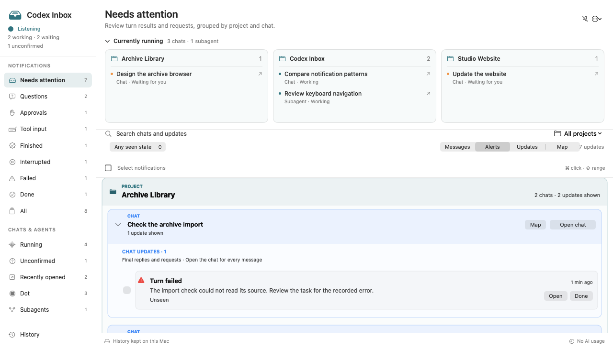
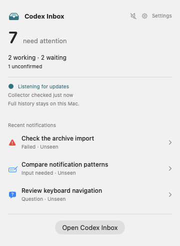

# Codex Inbox


A native macOS inbox for keeping up with Codex tasks, questions, approvals, and turn results. See what needs attention across chats and subagents, browse saved activity, and open a task in Codex when you are ready to respond.



The menu-bar card provides a compact overview:



*Screenshots use sample data.*

## What it does

- Collects questions, approval and connector requests, and completed, interrupted, or failed turns. Notifications can appear as macOS banners with an optional sound.
- Shows active and waiting tasks by project, alongside an inbox that can be searched and filtered. A menu-bar card provides a compact overview; the Dock icon is optional.
- Keeps **Seen** and **Done** separate: opening an alert records it as seen, while Done and Reopen let you manage your attention. A later message in the same task or a recorded answer can also clear an alert from Needs attention.
- Displays locally saved messages and a conversation map for a chat and its subagents. History records captured activity, opening attempts, and attention changes.
- Opens a selected task in an existing Codex window, or starts Codex normally if it is closed. Opening an alert does not mark it Done.

## Requirements

- macOS 14 or later and the Codex desktop app, with local Codex data available.
- Xcode command-line tools and `/usr/bin/python3` to build and run from source. No packages need to be downloaded.
- macOS notification permission if you want banners. Codex Inbox continues collecting when its window is closed, but stops when you quit the app.

## Build and run

From the repository root, build an ad-hoc-signed app and open it:

```sh
zsh build.sh
open "dist/delivery/Codex Inbox.app"
```

The build refuses to overwrite an existing `dist/delivery/Codex Inbox.app`; move or remove a previous **build candidate** before building again. This local build is not notarized and macOS may require you to approve it in Privacy & Security.

Allow notifications when prompted, then open Codex Inbox from its menu-bar icon. To start it automatically at login, add the app to macOS Login Items; the app does not install a login item itself.

## Privacy and storage

Codex Inbox reads Codex's local history databases and listens to its local IPC stream. It does not modify Codex's data, submit approvals, start turns, or make model/API inference calls. Alerts and activity are stored locally in `~/Library/Application Support/Codex Inbox/`, including `activity.sqlite`. This journal has no automatic deletion limit and can contain task and message details. Existing legacy inbox files are preserved during migration.

The app periodically sends a low-frequency HTTPS HEAD request to Apple for a coarse clock sanity check. It does not send inbox content in that request. Clock checks are not signed or precision timestamps, and the app does not change your Mac's clock.

## Coverage and limitations

- The collector relies on private Codex interfaces and local database formats, which can change. An incompatible live stream produces a warning; locally retained history is a fallback when available.
- Remote tasks are followed when observed, but unannounced remote tasks and complete cloud coverage are not guaranteed. Cloud transcripts may not be available to the Messages and Map views.
- Events that occur while the app is disconnected may be recovered from retained local history; transient approvals that appear and resolve during a disconnection may be missed. Sleep suspends local execution.
- Running counts include confirmed working and waiting tasks. Previously active tasks without fresh status are shown separately as Unconfirmed; silence does not imply completion.
- A reply-panel countdown is an estimate, not an answer deadline. A disappearing request or expired timer does not by itself mean it was answered.
- Opening records the attempt and macOS acceptance or failure, but acceptance does not prove Codex displayed the intended task. Locked-screen notification delivery has not been human-tested.

## Development

```sh
zsh test.sh
```

See [development notes](docs/development.md) for components and focused tests, and [activity history](docs/activity-history.md) for storage and timestamp details.

To remove the app, quit it and delete the app bundle. Its support folder is separate; retain it to keep your inbox history, or delete it if you no longer need that data.
